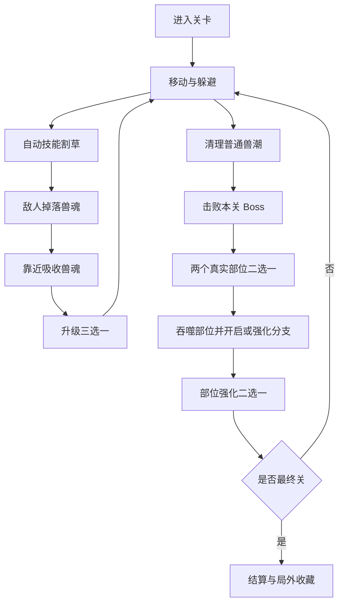

# 《山海吞噬录》游戏策划案（GDD）

> V1.1｜网页端全屏3D像素风｜360°水平旋转视角｜吞噬进化 + Roguelike割草 + 自由融合
>
> 当前原型数据：见 [data/](data/)，版本为 v0.1-draft。现有 Phaser 版本是玩法验证原型；本策划案新增的 3D 全屏版本属于下一阶段生产方向，运行时数值和内容配置以数据文件为准。

## 一、项目定位

**一句话玩法：** 从幼年饕餮出发，以自动技能割草为主，吸收普通敌人掉落的兽魂升级；每关击败 Boss 后从两个真实部位中选择一个吞噬，逐步形成独一无二的洪荒神兽。

| 项目 | 设计 |
|---|---|
| 核心节奏 | 割草为主，兽魂升级，Boss 部位吞噬决定构筑方向 |
| 平台 | 网页端全屏，桌面浏览器优先，平板和手机横屏适配 |
| 视角 | 3D像素风；水平视角支持 0–360°旋转，俯仰角受控 |
| 单局 | 3关，约9–11分钟 |
| 操作 | WASD/左摇杆移动，鼠标拖拽或右摇杆转镜头，自动攻击，主动冲刺 |
| 原型引擎 | Phaser 4.2.1 + TypeScript + Vite |
| 生产引擎 | Three.js + TypeScript + Vite；保留现有 JSON 数据和战斗规则 |
| 商业化 | 后续接入平台支持的激励广告 |

四大设计目标：割草时有持续的战力爆发；兽魂吸收能推动升级；Boss 部位吞噬同时改变外观和能力；旋转视角让玩家看见自己的 3D 进化形态和立体战场。

参考方向为 [PokéBonk](https://pokebonk.com/) 这类浏览器 3D Survivor：全屏 WebGL 画布、敌群生存、进化和短局循环。项目只借鉴交互形态和技术方向，不使用其 Pokémon 角色、名称、模型、音频或其他受版权保护的资源。

## 当前开发状态与架构升级（2026-11-04）

- **引擎架构升级：** 全仓库已正式完成从 Phaser 2D 向 **Three.js + TypeScript + Vite** 的完整生产级架构迁移。
- **3D场景与镜头：** 现已实现真正的全屏 3D WebGL 渲染，透视相机支持 0–360° 水平自由偏航旋转、30°–65° 俯仰角限位、滚轮缩放与平滑跟随，按 `R` 可随时回正至角色后方。
- **3D角色与部位槽位：** 幼年饕餮主体已升级为 3D 低模；神兽部位（狐口、九尾、夔牛雷角、夔牛蹄、穷奇之翼）已实现动态 3D 挂点系统，当玩家吞噬部位后，角色 3D 外观即时发生立体蜕变。
- **3D关卡环境与特效：** 青丘之野（灵石图腾与玉色雾气）、炎火山（黑曜石地脉与熔岩火隙）、穷奇竞技场（悬浮符文巨石与暗紫虚空）三大 3D 战场及撕咬巨口、追踪火球、落雷光柱、Boss 地面预警圈均已实现 3D 渲染。
- **数据层与战斗完整性：** 100% 保持 [data/](data/) 下平衡、怪物、技能、部位、分支和多语言配置的一致性；暴食反冲、吞火回响、灼热冲锋等全套构筑联动与数值计算完整保留。
- **UI与控制：** 响应式东方奇幻风格全屏 HUD（HP/EXP/Boss 血条/技能/分支徽章/兽魂计数器），升级三选一、Boss 部位二选一、部位强化与通关结算弹窗；支持 PC 键鼠与移动端虚拟摇杆+冲刺按钮。
- **局外解锁：** 击败最终 Boss 穷奇后将「穷奇之翼」自动持久化至 `localStorage`（`beast-evo-unlocks`）。
- **自动化验收：** 已编写并通过 Playwright 3D 全流程测试（`npm test`），涵盖 WebGL 渲染、移动冲刺、360° 旋转、3 关 Boss 战、部位吞噬升级与最终通关解锁。

## 二、世界观与视觉风格

洪荒灵气失衡，异兽争夺「山海本源」。玩家是一只未定形幼兽，通过吞噬百兽重塑神躯。角色以《山海经》为灵感进行原创化设计。

- **画风：** 东方奇幻低多边形像素风；墨黑、岩灰、土金为基础色，火焰朱红、雷电青蓝、稀有紫色。
- **渲染方式：** 低多边形 3D 网格 + 像素纹理 + Flat Shading + 最近邻采样；通过低内部分辨率、像素化后处理和有限色板保持像素观感。
- **镜头：** 3D 透视相机，水平偏航支持 0–360°连续旋转；俯仰角暂定 30°–65°，不开放完整垂直翻转，避免战斗读图和眩晕失控。镜头围绕玩家平滑跟随，可一键回到玩家后方。
- **画布：** WebGL 全屏画布，默认横屏和桌面宽屏；支持窗口缩放、浏览器 Fullscreen API、刘海和安全区域适配。移动端竖屏显示旋转设备提示，不把 360×640 作为固定逻辑视口。
- **角色：** 幼兽使用 3D 低模，体型和部位必须在任意水平角度下保持可读；主体、头、翼肢、尾、甲采用独立节点或骨骼挂点。
- **地图：** MVP 制作「青丘之野」3D 战斗区；第二阶段加入「炎火山」和「穷奇竞技场」；地图采用有限高度差、坡面、台地和地标，不在首个 3D 切片加入复杂多层迷宫。
- **特效：** 像素粒子、低模投射物、屏幕空间命中反馈、轻微镜头震动；所有特效都需要设置总量上限和低画质降级。

### 全屏与镜头控制

| 平台 | 移动 | 镜头旋转 | 缩放 | 冲刺/辅助 |
|---|---|---|---|---|
| 桌面浏览器 | WASD / 方向键 | 按住鼠标右键拖拽，或中键拖拽 | 鼠标滚轮 | Space；`R` 回到玩家后方；`F` 请求全屏 |
| 平板横屏 | 左侧虚拟摇杆 | 右侧滑动区域 | 双指捏合 | 右下按钮；镜头回正按钮 |
| 手机横屏 | 左侧虚拟摇杆 | 右侧滑动区域 | 双指捏合 | 右下按钮；进入游戏后提示全屏 |

全屏必须由用户点击开始按钮后调用浏览器 Fullscreen API，页面加载时不强制接管用户屏幕。镜头旋转区域与技能、冲刺和升级卡区域分开，避免触控冲突。镜头只允许水平 360°连续旋转，俯仰角保持在 30°–65°；默认提供反转 Y、灵敏度和自动回正设置。

## 三、核心玩法循环



### 吞噬规则

普通敌人不直接被吞噬。技能击杀普通敌人后会掉落兽魂；兽魂在场上停留约25秒，玩家需要靠近才能吸收。兽魂主要用于经验升级，不再额外引入一套复杂的普通敌人吞噬货币。

真正的吞噬发生在 Boss 战结束后：玩家从 Boss 的两个真实身体部位中选择一个，立即装备并获得对应能力，同时登记图鉴发现；随后从该部位的两个强化方向中选择一个，再进入下一关。部位会替换同槽位旧部位，图鉴发现立即保留，正式装备池在本局完成后开放。

玩家主体决定核心玩法；Boss 部位改变玩法方向。第一版主体固定为幼年饕餮，成长分为暴食、凶躯、贪炎三条分支。

## 四、割草战斗系统

玩家在 3D XZ 平面移动，Y 轴由地形高度决定；技能自动寻找目标，冲刺是基础操作，不占主动技能槽。镜头旋转与角色移动方向解耦，玩家可以一边绕场观察，一边保持自己的移动方向。基础撕咬固定存在，另外逐步获得两个随机主动技能。

### 3D战斗规则

- 玩家移动使用世界坐标，左摇杆或 WASD 决定移动向量。
- 鼠标拖拽、右键拖拽或移动端右侧滑动只改变镜头偏航，不直接改变玩家位置。
- 角色攻击朝向默认取移动方向；停止移动时，保留最近一次有效方向。
- 自动技能以世界空间索敌，优先选择攻击范围内的最近、精英或 Boss 目标。
- 所有攻击碰撞使用圆形、胶囊体、扇形或投射物体积，不依赖 2D Sprite 的像素碰撞。
- 地形首版只做可走坡面和少量台地；高度差影响可见性和特效表现，不在 MVP 引入复杂跳跃和空中战斗。
- 镜头旋转不能破坏敌人可读性：屏幕边缘显示敌群方向提示，植被和遮挡物对玩家、兽魂和 Boss 自动淡出或半透明。

| 技能 | 初始效果 | 三阶段方向 |
|---|---|---|
| 饕餮撕咬 | 自动朝移动方向近战攻击 | 受到分支和部位强化 |
| 饕餮巨口 | 前方扇形伤害与吸附 | 扩大范围、增强吸附、命中回血 |
| 九尾妖火 | 自动追踪火球 | 分裂、灼烧、死亡爆裂 |
| 夔牛雷霆 | 预警雷击 | 连锁、雷区、麻痹 |

前两次升级保证分别获得两个随机主动技能；之后升级池混合出现新技能、已有技能强化、通用属性和已开启分支节点。每次升级暂停游戏，随机提供三项选择。技能前三次选择改变行为，达到第三阶段后继续出现时只做数值强化。

## 五、自由融合进化系统

| 槽位 | 真实部位示例 | 作用 |
|---|---|---|
| 头部 | 狐口、獠牙、雷角 | 攻击属性、兽魂、控制 |
| 翼肢 | 翅膀、利爪、蹄、腿 | 冲刺、移速、近战 |
| 尾部 | 九尾、尾刃、触须 | 追加攻击、范围、持续效果 |
| 甲壳 | 龟甲、鳞片、骨甲 | 护盾、减伤、反伤 |
| 主体 | 幼年饕餮 | 核心玩法，不占部位槽 |

**获得流程：** 清理本关兽潮并击败 Boss → 展示两个真实部位 → 预览装配前后外观、分支和属性 → 确认吞噬 → 选择该部位的两个强化方向之一 → 角色外观和能力立即改变。每槽位仅装备一件；替换必须提示原能力会消失。

**组合联动：**
- 暴食反冲：暴食节点与凶躯节点同时存在时，吸收兽魂后强化下一次冲刺。
- 吞火回响：暴食节点与贪炎节点同时存在时，吸收兽魂后强化下一次火焰攻击。
- 灼热冲锋：凶躯节点与贪炎节点同时存在时，冲刺穿过灼烧目标会产生爆炸。

**3D实现：** 主体、角、翼、尾、甲分别为独立节点或骨骼挂点；配置节点名称、局部偏移、缩放、材质和层级。动画统一使用 `idle/run/hit/attack/dash`，角色不再按四方向复制 Sprite，而是使用一套低模动画配合自由镜头。碰撞盒、攻击体和视觉部件解耦。MVP 不做复杂动态骨骼重建，只做固定挂点、少量骨骼和可替换 GLB 部件。

## 六、怪物与关卡

| 怪物 | 类型 | 行为/作用 |
|---|---|---|
| 灵虫 | 普通 | 漫游，掉落少量兽魂 |
| 灵鼠 | 普通 | 逃离玩家，引导追击 |
| 山精 | 普通 | 近战追击 |
| 赤羽鸟 | 普通 | 快速穿梭 |
| 岩甲兽 | 普通 | 高防低速 |
| 九尾狐影 | 第一关 Boss | 狐火、尾焰；狐口或九尾二选一 |
| 夔牛残灵 | 第二关 Boss | 雷区、连锁雷击；雷角或夔牛蹄二选一 |
| 穷奇 | 最终 Boss | 冲刺、扇形攻击、召唤和狂暴 |

精英怪只提供大量普通兽魂，不掉独立部位，不弹出独立强化奖励。穷奇之翼作为首次击败最终 Boss 后的局外解锁内容。

| 关卡 | 事件 | 目标体验 |
|---|---|---|
| 第1关 | 90秒兽潮 → 九尾狐影 → 狐口/九尾二选一 | 学会移动、兽魂、技能和主分支 |
| 第2关 | 120秒强化兽潮 → 夔牛残灵 → 雷角/夔牛蹄二选一 | 强化主分支或开启副分支 |
| 第3关 | 150秒变异兽潮 → 穷奇最终 Boss | 检验完整构筑并结算 |

## 七、UI/UX整体设计

### 页面结构

```text
启动页
└─主界面
  ├─开始游戏→关卡选择→战斗HUD
  │                     ├─升级三选一
  │                     ├─部位获得弹窗
  │                     ├─暂停设置
  │                     └─胜败结算
  ├─异兽图鉴
  ├─天赋升级
  └─设置
```

### 主界面
顶部为 Logo、货币与设置；中央展示可以旋转预览的幼兽 3D 像素模型；底部为「进入山海」主按钮与图鉴、天赋次入口。背景采用低多边形山峦、雾层和少量灵气粒子。

### 战斗HUD（全屏优先）

```text
┌────────────────────────────────────┐
│ Lv8  HP █████░  EXP ███░░  02:15   │
│ Boss：九尾狐影 ███████░░░          │
│                                    │
│         3D战斗空间 / 旋转镜头       │
│                                    │
│                                    │
│ [左摇杆]                    [冲刺] │
│                         [右侧旋转区]│
│          技能1  技能2  技能3        │
└────────────────────────────────────┘
```

- 顶部固定血量、经验、时间、资源；Boss 出现时显示独立血条和当前阶段。
- 桌面端默认使用 WASD + 鼠标拖拽镜头 + Space 冲刺；按住 `R` 或点击镜头按钮可回到玩家后方。
- 移动端使用左下移动摇杆、右侧滑动旋转镜头、右下冲刺；双指捏合缩放，UI 触摸区域不参与镜头旋转。
- 避开浏览器和手机安全区域，HUD 使用固定屏幕层，不随 3D 相机移动。
- 屏幕边缘显示离屏敌人、兽魂和 Boss 方向，避免自由旋转后玩家丢失目标。

### 升级三选一
战斗暂停、背景压暗，三张像素卡片展示图标、名称、等级、简短效果、稀有度。桌面端横向排列，窄屏端纵向排列，选择后播放进化反馈。

### 部位奖励
中央突出新部位 3D 模型；展示角色装配前后对比、属性变化和组合联动；玩家可以拖拽预览模型的水平旋转；按钮「融合进化」或「替换部位」。

### 角色成长与图鉴
中央展示组合后的 3D 角色，支持拖拽旋转和局部放大；周围显示角、翼、尾、甲四槽；下方显示生命、攻击、速度、吞噬范围与技能。未发现异兽以低模剪影呈现。部位变化应能从至少三个连续角度清晰看见，避免只在固定正面有效。

### 关卡与结算
关卡使用 3D 场景预览卡片；结算展示存活时间、击杀、吞噬、进化次数、最终形态与奖励。暂停页包含继续、镜头灵敏度、镜头反转、画质、全屏和退出。画质设置至少包含低、中、高三档，低画质关闭部分阴影、雾效、粒子和屏幕后处理。

## 八、数值初值与配置

| 指标 | 建议初值 |
|---|---:|
| 生命 | 100 |
| 攻击 | 10 |
| 移速 | 140 px/s |
| 冲刺冷却 | 6秒 |
| 冲刺持续时间 | 0.25秒 |
| 兽魂吸收半径 | 42 px |
| 兽魂场上存在 | 25秒 |
| 首次升级经验 | 100 |
| 升级经验倍率 | 1.18 |
| 技能行为阶段 | 3段，之后转数值强化 |
| 部位槽 | 4个，主体单独计算 |
| 3D镜头水平旋转 | 0–360°连续偏航 |
| 3D镜头俯仰 | 30°–65°可调范围 |
| 默认镜头模式 | 透视相机，平滑跟随，支持回正 |
| 战斗空间 | 3D XZ 平面，首版有限高度差 |

运行时以 [data/balance.json](data/balance.json) 为全局数值入口，以 [data/creatures.json](data/creatures.json)、[data/skills.json](data/skills.json)、[data/parts.json](data/parts.json)、[data/waves.json](data/waves.json)、[data/stages.json](data/stages.json) 和 [data/growth.json](data/growth.json) 为内容配置。中英文名称在 `data/locales/` 下维护。

当前所有数字仍是首轮测试值。修改数据后运行 `npm run validate:data`，构建前运行 `npm run build`。

## 九、技术架构与3D迁移

现有原型采用 Phaser 4.2.1 + TypeScript + Vite，导出静态 Web 文件。Phaser 版本继续作为玩法验证基线；生产 3D 版本建议迁移到 Three.js + TypeScript + Vite。原因是本项目现在需要真实 3D 网格、深度遮挡、可旋转透视相机、3D 粒子和 GLB 资源，继续用 2D 框架拼接伪 3D 会增加后续重构成本。

3D 版本的首选渲染方案：

- `WebGLRenderer` 作为 MVP 主渲染器，浏览器进入游戏前检查 WebGL 能力；不支持时显示兼容性提示。
- `PerspectiveCamera` 负责 360°水平偏航、受限俯仰、平滑跟随和镜头回正。
- `GLTFLoader` 加载角色、Boss、部位和场景模型；模型以 GLB 为交付格式。
- 低模网格、像素纹理、Flat Shading、NearestFilter 和有限色板共同实现 3D 像素风。
- 游戏逻辑、战斗数据、升级卡、Boss、分支和存档继续复用现有 JSON，不随渲染迁移重写。
- WebGPU 只作为后续实验方向，不作为 MVP 的运行前提。

主要模块：

- `GameScene`：地图、主循环与关卡状态。
- `PlayerController`：移动、冲刺与状态。
- `EnemySpawner`：刷怪与波次。
- `CombatSystem`：索敌、碰撞、伤害与技能。
- `SoulSystem`：兽魂掉落、吸收、经验与升级。
- `BossPartSystem`：Boss 部位二选一、槽位替换和分支登记。
- `EvolutionSystem`：三选一、装配与联动。
- `CameraController`：镜头偏航、俯仰、缩放、回正和遮挡处理。
- `CreatureRenderer3D`：GLB 模型、部位节点、动画状态和像素材质。
- `TerrainSystem`：地形高度、可走区域、坡面和场景边界。
- `SpatialQuery`：XZ 平面空间分区、索敌和屏幕外实体降频。
- `UIManager`：HUD、弹窗与结算。
- `SaveManager`：局外成长与存档。
- `AdAdapter`：广告接口预留及无广告降级。

3D 性能使用对象池、XZ 空间分区、GPU instancing、模型 LOD、屏幕外降频、阴影分级和粒子上限。首个 3D 纵向切片不直接提高敌人数量，先沿用第一关 24、第二关 34、第三关 44 的活怪上限；在实机 profiling 后再考虑提升到 60/90/120。

当前 Phaser 构建已经出现大于 500 kB 的 chunk 警告，3D 迁移后需要把 Three.js、场景模型和非首屏资源拆成动态加载，避免全屏 WebGL 首次打开时同时下载全部内容。加载页需要显示资源阶段和可重试状态。

### 3D坐标与相机基线

- 1 个世界单位不与旧版像素直接等价；旧数值只负责战斗平衡，渲染层单独设置单位换算。
- 玩家默认位于相机关注点附近，镜头距离暂定 14–18 世界单位。
- 相机默认俯视角约 45°，允许玩家在 30°–65°范围内调整俯仰。
- 镜头水平旋转采用平滑阻尼，旋转速度支持设置；玩家可以一键回到角色后方。
- 角色、兽魂、Boss 和危险区使用屏幕空间轮廓或边缘提示，解决自由镜头下的遮挡问题。

### 3D数据扩展

现有 `creatures.json`、`parts.json` 和 `stages.json` 的战斗字段继续沿用；3D 版本新增渲染字段时，建议只扩展数据结构，不把模型路径写进战斗逻辑。例如：

```json
{
  "id": "nine_tail_shadow",
  "modelKey": "creature.nine_tail_shadow.glb",
  "collider": { "shape": "capsule", "radius": 0.8, "height": 1.6 },
  "render": {
    "lod": ["high", "mid", "low"],
    "outline": "boss",
    "shadow": "soft"
  }
}
```

部位数据可以增加 `modelKey`、`attachNode`、`localOffset`、`localScale` 和 `materialKey`；技能数据可以增加 `volumeShape`、`heightMode`、`vfxKey` 和 `cameraCue`。这些字段只负责表现和碰撞形状，伤害、冷却、分支和联动仍由现有数值字段控制。

### 图片与美术资产流程

当前可玩原型已经接入第一批 2D 像素化角色和背景；3D 版本需要重新建立模型和场景资产流程：

1. 使用 `image_gen` 或概念绘图锁定主体、Boss 和部位的轮廓、配色、材质和像素密度，先确认任意水平角度下的辨识度。
2. 在 Blender 或同类工具中制作低多边形模型，主体、头部、翼肢、尾部和甲壳分别保持独立节点或可替换网格。
3. 制作低分辨率像素纹理和有限色板，统一采用最近邻采样；避免高频真实感贴图破坏像素风。
4. 以 GLB/GLTF 输出模型、骨骼、节点命名和动画；动画统一使用 `idle/run/hit/attack/dash/death` 命名。
5. 为每个部位配置挂点、局部偏移、缩放、材质和碰撞盒；视觉网格修改不能直接改变战斗数值。
6. 建立三档 LOD 和低画质替代材质，确保全屏 3D 敌群在真实浏览器设备上稳定运行。

当前已接入的素材见 [public/assets/generated/](public/assets/generated/)，生成源图和裁切预览见 `output/imagegen/`。

生成图只作为素材生产步骤，不能替代清稿、授权确认和实机可读性检查。

## 十、局外成长与广告

每局获得「山海本源」，可小幅强化生命、攻击与初始吞噬范围；后续解锁幼兽、地图和图鉴。永久强化不能强到取代局内选择。

广告后续可设计为自愿复活一次、结算奖励加倍、非核心资源补给。实际能否接入取决于H5分发平台；核心部位不得强制看广告获取。

## 十一、MVP开发计划

| 阶段 | 内容 | 验收 |
|---|---|---|
| P0 | Phaser 4 玩法原型、移动、刷怪、基础攻击、兽魂与冲刺 | 已完成；构建、数据校验和浏览器加载通过 |
| P1 | 两个主动技能、经验、升级三选一、第一关 Boss 部位奖励 | 已完成首轮验收；Boss 攻击、部位效果、部位强化和分支联动已接入 |
| P2 | 三关 2D 完整流程、穷奇、结算和首次解锁 | 已完成首轮验收；现有 Phaser 原型作为玩法基线保留 |
| P3 | Three.js 全屏 3D 壳、WebGL 检查、透视相机和 360°水平旋转 | 待开发；先验证窗口缩放、全屏、镜头回正、鼠标拖拽和移动端右摇杆 |
| P4 | 青丘之野 3D 纵向切片、3D 玩家、普通敌人、兽魂和升级 | 待开发；要求完整跑通一局 90 秒普通波次和第一次升级 |
| P5 | 九尾狐影 3D Boss、部位模型、遮挡提示、部位二选一和局内换装 | 待开发；要求旋转镜头下仍能看懂预警和部位差异 |
| P6 | 炎火山、穷奇竞技场、三关结算、性能、本地化和音效 | 待开发；根据实机 profiling 决定是否提高敌人和特效数量 |

**首版不做：** 多人、联网 PVP、开放世界、复杂多层迷宫、完整空中战斗、几十种异兽、动态骨骼重建、复杂装备经济。

## 十二、测试指标与风险

重点验证：玩家能否在 30 秒内理解“普通敌人掉兽魂、Boss 才掉真实部位”；旋转镜头后是否仍能判断敌群、危险区和兽魂位置；前两次升级是否能稳定拿到两个主动技能；第一关 Boss 部位选择是否改变下一关的战斗决策；三关总时长是否落在 9–11 分钟；WebGL 加载、全屏适配、镜头操作和真实设备帧率是否达标。

现有 Phaser 浏览器验收已覆盖：页面加载、WASD/方向键移动、鼠标指向、移动端触控摇杆、Space/触控冲刺、兽魂生成与吸收、部位回血、火焰灼烧、雷击麻痹与连锁、冲刺撞击、升级卡片点击、升级后继续战斗、第一关 Boss 预警区、Boss 阶段伤害、首个部位奖励、部位强化二选一、程序化部位表现、分支第二节点、第二关 Boss、第三关穷奇、胜利结算和 `qiongqi_wing` 首次解锁。3D 版本新增验收：WebGL 检查、浏览器全屏、窗口缩放、360°水平旋转、俯仰限制、镜头回正、鼠标/右摇杆双输入、敌群边缘提示、遮挡淡出、3D 模型部位替换和低画质降级。

主要风险及应对：
1. **3D资产成本高：** 固定低模面数、有限色板、少量部位和三档 LOD；先制作一只玩家、一个普通敌人和一个 Boss 的可复用模板。
2. **吞噬与割草割裂：** 吞噬产出成长资源，技能提高吞噬效率，部位联动两者。
3. **3D性能压力：** 对象池、XZ 空间索敌、GPU instancing、LOD、阴影分级、屏幕外降频和特效上限。
4. **数值失控：** 联动内部冷却，体型与战斗数值分离。
5. **自由镜头导致信息丢失：** 屏幕边缘方向提示、Boss 标记、危险区轮廓、遮挡淡出和一键回正。
6. **镜头眩晕和输入冲突：** 限制俯仰角、平滑阻尼、灵敏度设置、移动端旋转区与 UI 分离。
7. **海外理解门槛：** 简短英文文案、视觉教学、低文本依赖。

## 十三、优先开发的纵向切片

**当前 3D 切片目标：** 全屏 WebGL 画布 → 3D 青丘之野 → 360°水平旋转镜头 → 幼年饕餮在 XZ 平面移动 → 自动撕咬与主动技能割草 → 敌人掉落兽魂 → 靠近吸收并升级三选一 → 九尾狐影 3D Boss → 狐口/九尾二选一 → 旋转预览并装备部位 → 登记主分支并进入第二关。先确认“3D旋转镜头不影响战斗可读性”“割草成长成立”和“Boss部位构筑改变下一关决策”三个条件，再扩展夔牛和穷奇的 3D 资产。

**已确认决策：** 网页端全屏优先；桌面横屏为首要验收尺寸，移动端支持横屏和触控；3D 低模像素风；水平偏航支持 0–360°，俯仰角受控；普通敌人只掉兽魂；Boss 部位每关二选一；每个异兽保留自己的成长线，同时通过暴食、凶躯、贪炎三条公共分支提供组合联动；局内获得的部位在本局生效，首次通关内容再进入局外解锁池。
